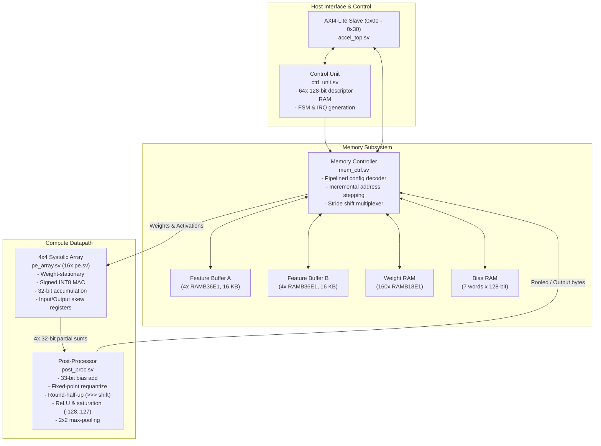

# INT8 CNN Hardware Accelerator

A synthesizable SystemVerilog implementation of an integer convolutional neural network (CNN) inference accelerator. The design uses a 4x4 weight-stationary systolic array, synchronous Block RAM feature buffers, and an AXI4-Lite control interface. It has been evaluated using Icarus Verilog for functional verification and AMD Vivado for FPGA implementation targeting an Artix-7 200T FPGA.

---

## What it does

The accelerator executes forward inference for a small convolutional neural network trained on the MNIST dataset ($28 \times 28$ grayscale images of handwritten digits).

The model topology implemented in hardware is:
- **Input:** $28 \times 28 \times 1$ image, padded to 4 channels ($28 \times 28 \times 4$) to align with the 4-lane systolic array.
- **Layer 0 (Conv1):** 2D convolution ($3 \times 3$ kernel, 4 input channels, 8 output channels, stride 1, padding 1), bias addition, fixed-point requantization, ReLU activation. Output: $28 \times 28 \times 8$.
- **Layer 1 (Pool1):** $2 \times 2$ spatial max pooling (stride 2). Output: $14 \times 14 \times 8$.
- **Layer 2 (Conv2):** 2D convolution ($3 \times 3$ kernel, 8 input channels, 8 output channels, stride 1, padding 1), bias addition, fixed-point requantization, ReLU activation. Output: $14 \times 14 \times 8$.
- **Layer 3 (Pool2):** $2 \times 2$ spatial max pooling (stride 2). Output: $7 \times 7 \times 8$.
- **Layer 4 (FC):** Fully connected layer implemented as a $1 \times 1$ convolution (392 input values to 12 output entries). The first 10 entries represent the digit class logits (0 to 9), followed by 2 padding lanes. Output: 12 bytes.

The entire 5-layer inference completes in **53,836 clock cycles** on the accelerator.

---

## Architecture

The hardware is partitioned into modular blocks:



### Module Responsibilities
- **`pe.sv`**: Multiplies a signed 8-bit activation by an 8-bit weight, sign-extends the 16-bit product, and accumulates into a 32-bit register. Holds weights locally in stationary mode.
- **`pe_array.sv`**: Connects 16 PEs into a $4 \times 4$ grid. Includes input skew registers ($D_i = i$ cycles delay) and output deskew registers ($3 - j$ cycles delay) so diagonal wavefronts align properly.
- **`mem_ctrl.sv`**: Handles reading/writing the on-chip feature buffers, weights, and biases.
  - Features use two 16 KB ping-pong buffers (`feature_a` and `feature_b`), each mapped to 4 `RAMB36E1` primitives.
  - A 4-stage configuration state machine (`CONF_1` to `CONF_4`) precomputes layer dimensions and step increments, eliminating runtime division and multipliers from loop counters.
  - Generates read addresses incrementally using base registers (`cur_row_base`, `cur_x_offset`), avoiding chained DSP multipliers on memory address ports.
  - Stride multiplication uses power-of-2 shift multiplexers instead of DSP slices.
- **`ctrl_unit.sv`**: Stores up to 64 layer descriptors (128-bit wide), decodes 90-bit active configurations, sequences layer-by-layer execution, and asserts `irq` when `HALT` is reached.
- **`post_proc.sv`**: A 4-stage pipeline that adds 32-bit signed biases, applies fixed-point requantization (`round_shift`), applies round-half-up nearest integer rounding (`(val + (1 << (shift - 1))) >>> shift`), applies optional ReLU, saturates results to $[-128, +127]$, and handles $2 \times 2$ signed max-pooling.
- **`accel_top.sv`**: Connects the sub-blocks and exposes an AXI4-Lite slave interface with memory-mapped registers for host control.

---

## Numerical Representation & Quantization

The accelerator uses symmetric signed INT8 arithmetic:
- **Activations & Weights:** Signed 8-bit integers in the range $[-128, +127]$.
- **Accumulator:** Signed 32-bit integers to prevent overflow during sum-of-products reduction.
- **Bias Addition:** 32-bit signed bias added directly to the 32-bit accumulator without precision loss:
  $$\text{sum}_{33} = \text{psum}_{32} + \text{bias}_{32}$$
- **Requantization:** Scales the 32-bit value back to INT8 using an integer multiplier $M \in [0, 65535]$ and right shift $S \in [0, 31]$:
  $$\text{scaled} = \frac{\text{sum}_{33} \times M}{2^S}$$
- **Rounding:** Implements round-half-up (add half and arithmetic right shift / round half towards $+\infty$) matching the Python integer golden model. Exact halfway ties round upwards. Offline weight quantization from PyTorch floats uses `np.rint` (round-to-nearest-even).
- **Activation & Saturation:** Applies ReLU ($\max(0, x)$) if enabled in the layer descriptor, followed by hardware saturation clamping to $[-128, +127]$.

---

## FPGA Implementation Results

The design was synthesized, placed, and routed using AMD Vivado 2026.1 in Out-of-Context mode (`-mode out_of_context`).

- **Target FPGA:** AMD Xilinx Artix-7 200T (`xc7a200tfbg676-2`, speed grade `-2`)
- **Clock Constraint:** 10.000 ns (100.0 MHz, 50% duty cycle)

| Resource / Timing Metric | Baseline (Step C) | Intermediate (Step D) | Final Post-Route | Available in xc7a200t | Utilization |
| :--- | :---: | :---: | :---: | :---: | :---: |
| **Slice LUTs** | 40,674 | 6,096 | **6,199** | 133,800 | 4.63% |
| ├─ LUT as Logic | 12,487 | 6,069 | **6,172** | 133,800 | 4.61% |
| ├─ Distributed RAM LUTs | 28,160 | 0 | **0** | 46,200 | **0.00%** |
| └── Shift Registers (SRL) | 27 | 27 | **27** | 46,200 | 0.06% |
| **Slice Registers (FFs)** | 10,702 | 10,004 | **10,316** | 267,600 | 3.86% |
| **Total Slices** | 10,642 | 6,192 | **5,640** | 33,450 | 16.86% |
| **RAMB36E1 Primitives** | 0 | 8 | **8** | 365 | 2.19% |
| **RAMB18E1 Primitives** | 160 | 160 | **160** | 730 | 21.92% |
| **Total Block RAM Tiles** | 80 | 88 | **88** | 365 | **24.11%** |
| **DSP48E1 Slices** | 19 | 18 | **16** | 740 | **2.16%** |
| **Worst Negative Slack (WNS)** | $-12.971\text{ ns}$ | $-11.019\text{ ns}$ | **+0.621 ns** | — | **Timing Met** |
| **Total Negative Slack (TNS)** | $-814,952\text{ ns}$ | $-9,321\text{ ns}$ | **0.000 ns** | — | **0 Violations** |
| **Failing Setup Endpoints** | 219,987 | 4,293 | **0 / 24,292** | — | **0 Failing** |
| **Worst Hold Slack (WHS)** | $+0.139\text{ ns}$ | $+0.141\text{ ns}$ | **+0.102 ns** | — | **Timing Met** |
| **Estimated Max Freq ($F_{\text{max}}$)** | $\approx 43.5\text{ MHz}$ | $\approx 47.57\text{ MHz}$ | **106.62 MHz** | — | $T_{\text{min}} = 9.379\text{ ns}$ |

*Note on Implementation Metrics:* These numbers are static timing and place-and-route results reported by AMD Vivado 2026.1 (`post_route_timing_summary.rpt` and `post_route_utilization.rpt`). Physical board-level measurements have not been performed.

---

## Verification

The test suite runs with Icarus Verilog (`iverilog` v12.0) and is automated via PowerShell and Python:

```powershell
powershell -ExecutionPolicy Bypass -File .\scripts\verify.ps1 -PythonExe python
```

### Test Catalog:
1. `tb_pe`: Signed INT8 MAC arithmetic, zero multiplication, sign-extension, accumulation.
2. `tb_pe_array`: 4x4 array propagation, input skewing, output deskewing, valid tag framing.
3. `tb_post_proc`: Bias addition, fixed-point requantization, rounding ties, ReLU, saturation clamp, $2 \times 2$ max pooling.
4. `tb_directed_arith`: Corner-case arithmetic (saturation boundaries, extreme sums, signed pooling comparisons).
5. `tb_mem_ctrl_random`: 600 random DMA writes and 200 random reads across BRAM banks (seed `0x51a7c0de`).
6. `tb_mem_ctrl_zero_scan`: Zero-channel skipping logic on $28 \times 28$ 4-lane convolution descriptors.
7. `tb_ctrl_unit`: Descriptor loading, decoding, FSM sequencing, interrupt generation.
8. `tb_top`: AXI4-Lite register writes/reads (`0x00`–`0x30`), DMA streaming handshakes, status polling.
9. `tb_full_cnn`: Full 5-layer MNIST network comparing all 9,812 intermediate and final layer elements against a Python integer golden model. **0 mismatches, bit-exact match in 53,836 clock cycles**.
10. `tb_repeated_inference`: 2 consecutive full inference passes without asserting hardware reset. Confirms zero state leakage across runs (**107,672 clock cycles total**).

---

## Python Reference Model & Accuracy

The Python environment (`python/`) handles training, calibrated post-training quantization, and bit-exact golden vector generation:

- **Model Checkpoint:** `artifacts/mnist_cnn.pt` (PyTorch FP32 model).
- **Dataset:** Standard 10,000 MNIST test images (`data/MNIST/raw/`).
- **Calibration Set:** 1,024 images (seed 2027) used to record activation dynamic ranges.
- **Evaluation Command:**
  ```powershell
  python python\evaluate_mnist.py --checkpoint artifacts\mnist_cnn.pt --data data --samples 10000
  ```
- **Accuracy Results (10,000 test images):**
  - PyTorch FP32: **96.39%** (9,639 / 10,000 correct)
  - Calibrated INT8 Integer Model: **96.44%** (9,644 / 10,000 correct)
  - Quantization Delta: **+0.05%**

*Distinction:* The 96.44% accuracy is measured using the Python integer reference model across all 10,000 test images. The RTL simulation verifies bit-exact numerical identity ($error = 0$) against this Python integer reference for deterministic test vectors and single-image runs.

---

## RISC-V SoC Integration

The accelerator is designed to interface with an RV32I processor located in a companion repository (`PP/RISC-V`):

- **SoC Top Module:** `riscv_cnn_soc_top.sv`
- **Bus Adapter:** `accel_adapter.sv` (maps memory-mapped CPU stores/loads to AXI4-Lite).
- **Address Range:** `0x8000_1000` to `0x8000_10FF`.
- **Bus Handshake Watchdog:** The adapter (`accel_adapter.sv`) enforces a 16-bit hardware watchdog timer (limit: **65,535 clock cycles**) that protects individual AXI4-Lite bus transactions against slave lockup:
  - The watchdog timer counts only during an individual bus read or write handshake (`ST_WRITE` / `ST_READ`) and resets to zero upon returning to `ST_IDLE` on every transaction.
  - During accelerator execution, firmware polls the status register; each read completes in 1–2 cycles, resetting the counter and ensuring the watchdog never trips.
  - *Note on Latency Metrics:* The 65,535-cycle watchdog limit protects individual bus transfers and must not be directly compared with full inference latency to claim an inference safety margin.
- **Latency Breakdown (Reported Separately):**
  - Accelerator standalone hardware compute: **53,836 clock cycles** ($538.36\ \mu\text{s}$ at 100 MHz).
  - Total integrated SoC inference: **80,874 clock cycles** ($808.74\ \mu\text{s}$ at 100 MHz, including firmware setup, DMA input streaming, polling, and software argmax).
- **Co-Simulation Status:** Verified using `tb_riscv_cnn_soc.sv`:
  - `+CMD=2` (small CNN test): completed in 1,073 cycles with expected result `0x50084607`.
  - `+CMD=1` (MNIST sample 0): predicted digit 7 (score 47).
  - `+CMD=1` (MNIST sample 1): predicted digit 2 (score 34).

---

## Memory-Mapped Register Map

| Offset | Register | Access | Description |
| :---: | :--- | :---: | :--- |
| `0x00` | `CTRL` | R/W | Bit [0]: Start pulse (trigger inference), Bit [1]: Interrupt enable (`irq_en`) |
| `0x04` | `STATUS` | RO | Bit [0]: Busy, Bit [1]: Done, Bit [2]: Descriptor error |
| `0x08` | `VERSION` | RO | Static ID `0x01040408` (v1.4, $N=4$, $W=8$) |
| `0x10` | `DMA_ADDR` | R/W | 14-bit byte address pointer (auto-increments on `DMA_DATA` write) |
| `0x14` | `DMA_DATA` | WO | Bits [7:0]: Byte data, Bits [9:8]: Target (0=weights, 1=features, 2=biases) |
| `0x18` | `RES_ADDR` | R/W | Result byte address pointer (issues read strobe to feature buffer) |
| `0x1C` | `RES_DATA` | RO | Result byte readback |
| `0x20`–`0x2C` | `INSTR_W0`–`W3` | R/W | 128-bit layer descriptor staging registers |
| `0x30` | `INSTR_ADDR` | R/W | Instruction program counter (0–63) commit register |

---

## Running the Project

### Prerequisites
- **Simulation:** Icarus Verilog (`iverilog` v12.0+) and `vvp`.
- **Python:** Python 3.10+ with `numpy`, `torch`, `torchvision`.
- **FPGA Tools (Optional for re-implementing):** AMD Xilinx Vivado v2026.1.

### 1. Run the Full Functional Regression
```powershell
powershell -ExecutionPolicy Bypass -File .\scripts\verify.ps1 -PythonExe python
```
Expected output: All 10 testbenches report `PASS` and script exits with code 0.

### 2. Run Single-Image Manual Inference
Run inference on the included 28x28 sample digit (MNIST test sample 0):
```powershell
# Using the sample image:
python python\run_rtl_manual.py examples\sample_digit7.png

# Or using the raw NumPy array:
python python\run_rtl_manual.py --raw examples\sample_digit7.npy
```
Expected output: Predicted digit `7` (score: 47), 12/12 bytes match Python golden model in 53,836 cycles. Users may also provide their own 28x28 grayscale image as an argument.

### 3. Re-run Vivado Out-of-Context Implementation
```cmd
cd fpga
run_a200t.bat
```
Generates routed checkpoints and reports under `fpga/reports/a200t/`.

---

## Current Limitations

1. **No Physical Hardware Validation:** The project has been verified extensively in simulation and implemented through Vivado place-and-route. It has not yet been tested on physical FPGA development boards.
2. **Out-of-Context Implementation:** The accelerator is synthesized as an Out-of-Context IP block. Bitstream generation (`write_bitstream`) was not run because physical package pin assignments (`PACKAGE_PIN` and `IOSTANDARD`) are defined at the SoC board wrapper level.
3. **Fixed Systolic Dimension:** The systolic array size is fixed at $4 \times 4$. Channel counts must be padded to multiples of 4.

---

## Repository Structure

```
├── .github/workflows/       # GitHub Actions CI for portable simulation
├── artifacts/               # Model checkpoint (mnist_cnn.pt) & calibration JSON
├── data/                    # MNIST dataset directory (data/MNIST/raw/)
├── docs/                    # Technical engineering reports & architecture specs
│   ├── ARCHITECTURE.md      # Detailed microarchitecture specification
│   ├── VERIFICATION.md      # Testbench documentation & golden model validation
│   ├── FPGA_RESULTS.md      # Vivado synthesis, placement, routing, & timing reports
│   ├── SOC_INTEGRATION.md   # RISC-V SoC integration contract & co-simulation
│   ├── QUANTIZATION.md      # Quantization mathematics, scales, & accuracy
│   ├── REFERENCE_DESIGN_STUDY.md # Analysis of open-source reference designs
│   ├── FINAL_AUDIT_INVENTORY.md  # Artifact inventory & SHA256 checksums
│   └── FINAL_ENGINEERING_SIGNOFF.md # Master engineering scorecard
├── fpga/                    # Vivado scripts, constraints, reports, and checkpoints
│   ├── checkpoints/a200t/   # Routed design checkpoint (post_route.dcp)
│   ├── constraints/         # Clock constraint (clock.xdc - 100 MHz target)
│   ├── reports/a200t/       # Timing, utilization, and DRC reports
│   └── scripts/             # Vivado batch Tcl implementation scripts
├── python/                  # PyTorch model training, quantization, & manual runner
├── rtl/                     # Synthesizable SystemVerilog source files
├── scripts/                 # Regression scripts (verify.ps1)
├── tb/                      # SystemVerilog testbenches
├── vectors/smoke/           # Deterministic test vectors for regression
├── CONTRIBUTING.md          # Contribution guidelines
├── CITATION.cff             # Citation metadata
├── LICENSE                  # MIT License
└── README.md                # Project README
```

---

## References

During the development and optimization of this accelerator, several open-source reference architectures and Xilinx technical manuals were studied:
- **`dcgursoy/systolic-mnist`**: Reference for INT8 systolic array organization and weight staging.
- **`sharatchandra-ts/systolic-TPU-CNN-accelerator`**: Reference for 2D systolic dataflow and fixed-point requantization.
- **`taitashaw/fpga-ai-accelerator`**: Reference for Block RAM address decoupling and timing closure on Artix-7.
- **AMD Xilinx UG479 & UG478**: 7 Series DSP48E1 and Block RAM User Guides.

A detailed comparative study documenting architectural takeaways is available in [`docs/REFERENCE_DESIGN_STUDY.md`](docs/REFERENCE_DESIGN_STUDY.md).
