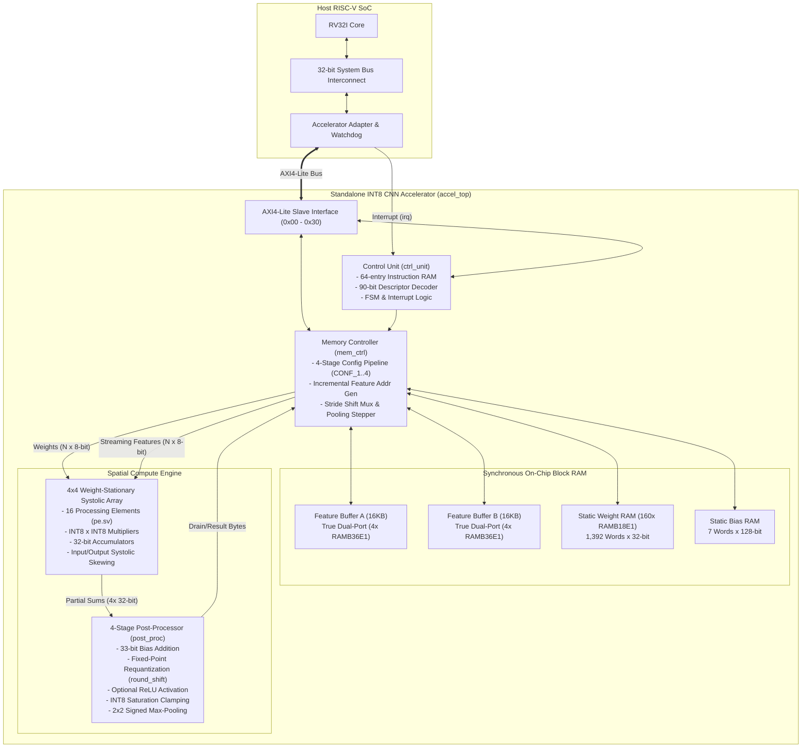

# Hardware Architecture & Microarchitectural Specification

**Project:** Standalone INT8 CNN Hardware Accelerator  
**Target FPGA:** AMD Xilinx Artix-7 200T (`xc7a200tfbg676-2`)  
**Clock Frequency:** 100.0 MHz ($T_{\text{clk}} = 10.0\text{ ns}$)  
**Integration:** Memory-mapped AXI4-Lite slave IP for RV32I Host SoC  

---

## 1. System Overview & Architecture Diagram

The accelerator is a domain-specific spatial processor designed for INT8 quantized convolutional neural network inference. It features a $4 \times 4$ weight-stationary systolic array, dual-port synchronous Block RAM ping-pong feature buffers, a 4-stage post-processing arithmetic datapath, and an AXI4-Lite control interface.

---

## 2. Microarchitectural Sub-Blocks

### 2.1 Processing Element (`pe.sv`) & Systolic Array (`pe_array.sv`)
- **Processing Element (PE):**
  - Signed $8\text{-bit} \times 8\text{-bit}$ multiplier generating a 16-bit intermediate product.
  - Sign-extended accumulation into a 32-bit accumulator register (`acc_q`).
  - Supports weight-stationary operation: static weights remain latched in `w_reg` while activations stream horizontally across rows.
  - Reset control resets accumulators per output tile without disturbing weight registers.
- **Systolic Mesh ($4 \times 4$):**
  - Dimensions: $N=4$ rows $\times$ $N=4$ columns (16 PEs total).
  - **Input Skewing:** Activations for row $i$ are delayed by $i$ clock cycles using shift registers to align with diagonally propagating systolic wavefronts.
  - **Output Deskewing:** Partial sums exiting column $j$ are deskewed by $3 - j$ cycles to present time-aligned 4-lane output vectors to the post-processor.
  - Valid framing tags propagate along with activations, gating accumulator updates cleanly.

### 2.2 Memory Controller (`mem_ctrl.sv`)
The memory controller orchestrates feature map buffering, weight streaming, address generation, and max-pooling writebacks:
1. **Pipelined Configuration State Machine:**
   - Evaluates layer descriptors in a 4-cycle state machine (`IDLE -> CONF_1 -> CONF_2 -> CONF_3 -> CONF_4 -> EXEC`).
   - Replaces 24 logic levels of dynamic division and multiplication with power-of-2 shifts and registered geometry constants (`row_pitch`, `col_step`, `row_step`).
2. **Incremental Address Generation:**
   - In convolution streaming, replaces combinational $y \times \text{stride} \times W \times C$ calculations with base-pointer accumulation (`cur_row_base` and `cur_x_offset`).
   - Address calculation collapses to a single 12-bit addition: `feature_read_addr = cur_row_base + cur_x_offset`.
3. **Max-Pooling Address Stepping:**
   - Incremental row/col stepping eliminates cascaded DSP multipliers in `WRITE_POOL`. Writes stream sequentially via `pool_write_addr <= pool_write_addr + 1'b1`.
4. **Stride Shift Multiplexing:**
   - Stride multiplication (`tile_origin_y * stride_val`) is replaced with power-of-2 shift multiplexers, completely eliminating DSP multiplier chaining.

### 2.3 Post-Processing Pipeline (`post_proc.sv`)
The post-processor converts 32-bit raw systolic partial sums back to calibrated signed INT8 feature bytes across a 4-stage registered pipeline:
1. **Stage 1 (Bias Addition):** Adds a 32-bit signed layer bias:
   $$\text{sum}_{33} = \text{psum}_{32} + \text{bias}_{32}$$
2. **Stage 2 (Fixed-Point Requantization):** Requantizes partial sums using a 16-bit unsigned multiplier and right shift:
   $$\text{scaled} = \frac{\text{sum}_{33} \times M}{2^S}$$
   Applies round-half-up (add half and arithmetic right shift / round half towards $+\infty$) matching the Python integer golden model.
3. **Stage 3 (Activation & Saturation):**
   - Applies optional ReLU: $x = \max(0, x)$.
   - Saturates 32-bit values to signed INT8 boundaries: $[-128, +127]$.
4. **Stage 4 (Max-Pooling & Packing):**
   - Implements $2 \times 2$ spatial max-pooling with signed comparisons across receptive fields.
   - Packs 4 lanes into 32-bit words for BRAM writeback.

### 2.4 Control Unit (`ctrl_unit.sv`)
- **Descriptor Memory:** 64-entry $\times$ 128-bit on-chip instruction memory.
- **Decoding:** Decodes 90-bit packed configuration structures (`layer_cfg_t`):
  - Layer opcode (CONV, POOL, FC, HALT).
  - Spatial dimensions: input height/width, output height/width, channels.
  - Padding, stride, kernel dimension, pooling enable, ReLU enable.
  - Requantization multiplier and right-shift amounts.
- **FSM Sequencing:** Sequences layer execution, monitors tile boundaries, and raises level-sensitive `irq` upon reaching `HALT`.

---

## 3. On-Chip Memory Organization

| Memory Block | Inferred Primitives | Organization | Addressing Mode | Purpose |
| :--- | :---: | :---: | :--- | :--- |
| `feature_a` | 4 $\times$ RAMB36E1 | 16,384 bytes (4,096 $\times$ 32-bit) | Byte / Word | Ping-pong activation buffer A |
| `feature_b` | 4 $\times$ RAMB36E1 | 16,384 bytes (4,096 $\times$ 32-bit) | Byte / Word | Ping-pong activation buffer B |
| `weights` | 160 $\times$ RAMB18E1 | 1,392 $\times$ 32-bit | Word | Static layer weights |
| `biases` | Distributed / BRAM | 7 $\times$ 128-bit | Word | Static layer biases (4 $\times$ INT32 per word) |
| `instruction_mem` | Distributed RAM | 64 $\times$ 128-bit | Word | Layer program descriptors |

### Ping-Pong Buffer Synchronization
Feature buffers switch roles on every layer boundary without moving physical data:
- **Layer 0 (Conv1):** Read `feature_a`, write `feature_b`.
- **Layer 1 (Pool1):** Read `feature_b`, write `feature_a`.
- **Layer 2 (Conv2):** Read `feature_a`, write `feature_b`.
- **Layer 3 (Pool2):** Read `feature_b`, write `feature_a`.
- **Layer 4 (FC):** Read `feature_a`, write `feature_b` (final logits).

---

## 4. Hardware Parameters (`cnn_pkg.sv`)

| Parameter | Value | Description |
| :--- | :---: | :--- |
| `DATA_W` | 8 | Activation and weight operand bit width (signed INT8) |
| `ACC_W` | 32 | Systolic accumulator and partial sum bit width (signed INT32) |
| `N` | 4 | Systolic array dimension ($4 \times 4$ processing elements) |
| `TILE_P` | 16 | Output spatial tile size ($P = 16$ parallel pixels) |
| `ADDR_W` | 14 | Internal byte address width ($2^{14} = 16,384$ bytes) |
| `PC_W` | 6 | Layer program counter width (up to 64 layer descriptors) |
| `INSTR_W` | 128 | Instruction memory word width |
| `CFG_W` | 90 | Active layer configuration descriptor bit width |
